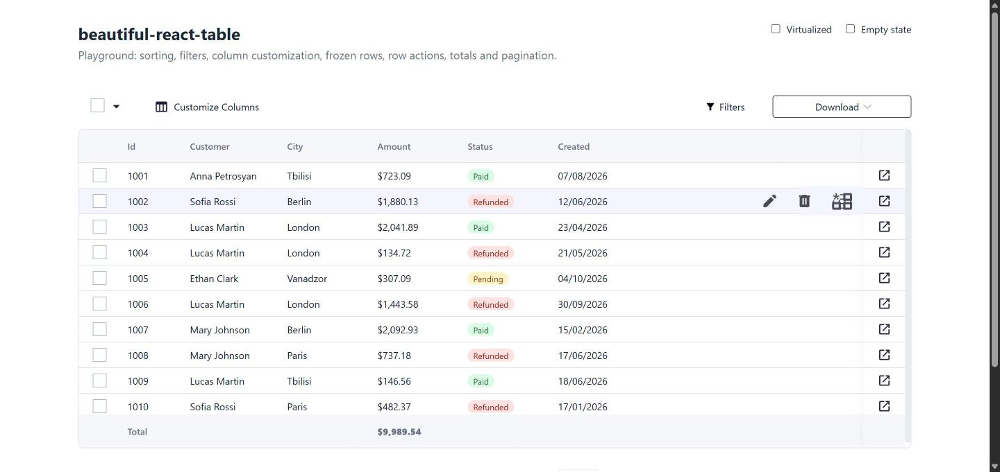
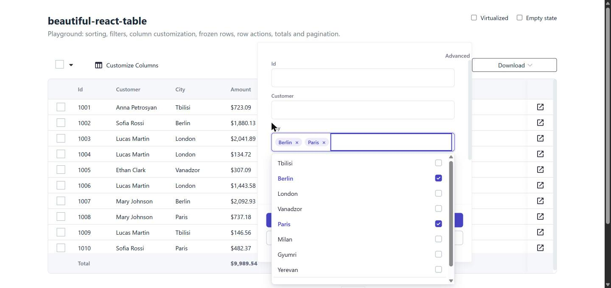

# beautiful-react-table

A feature-rich data table for React, built for admin panels: column customization with drag and drop,
frozen rows and columns, server-side filters, totals, row actions, selection, downloads and pagination.

[](https://www.npmjs.com/package/beautiful-react-table)




## Features

- **Column customization**: show/hide, reorder and pin up to three columns by drag and drop (mouse or keyboard)
- **Frozen rows**: pin up to three rows to the top while scrolling
- **Filters panel**: text, number and date-range filters, multi-select values with "load more", basic and advanced mode
- **Selection**: per-row checkboxes plus "select visible / select all / none"
- **Row actions** on hover, a sticky right column with a dropdown menu or a custom action
- **Totals footer** with per-column content
- **Pagination** with page-size select and "go to page"
- **Download** menu (XLSX / CSV) for checked rows or everything
- Fully **typed** (`<Table<Order> />`), keyboard accessible controls, works with **React 18 and 19** and **MUI 5, 6 and 7**



## Installation

```bash
npm install beautiful-react-table @mui/material @emotion/react @emotion/styled
```

| Peer dependency                         | Supported versions                 |
| --------------------------------------- | ---------------------------------- |
| `react`, `react-dom`                    | `^18.0.0 \|\| ^19.0.0`             |
| `@mui/material`                         | `^5.15.14 \|\| ^6.0.0 \|\| ^7.0.0` |
| `@emotion/react`, `@emotion/styled`     | `^11`                              |

Drag and drop (`@hello-pangea/dnd`), date pickers (`@mui/x-date-pickers`) and `dayjs` are installed automatically.
Styles are imported by the package itself; no CSS import is needed.

## Quick start

```tsx
import { useState } from 'react'
import {
  StructureConfig,
  Table,
  type IColumnConfig,
  type IColumnConfigStructure,
  type IColumnHeader,
  type IColumnHeaderStructure,
} from 'beautiful-react-table'

interface Agent {
  id: number // every row needs a unique id
  name: string
  createdAt: string
}

const rows: Agent[] = [
  { id: 1, name: 'Markos', createdAt: '2023-03-22' },
  { id: 2, name: 'Daniel', createdAt: '2023-03-22' },
]

// Headers and column configs are matched by position: headers[i] describes configs[i].
const headers: IColumnHeader[] = [
  { id: 1, order: 1, title: 'Name' },
  { id: 2, order: 2, title: 'Created' },
]

const configs: IColumnConfig<Agent>[] = [
  { id: 1, isVisible: true, title: (header) => header.title, setRow: (row) => <div style={{ width: 160 }}>{row?.name}</div> },
  { id: 2, isVisible: true, title: (header) => header.title, setRow: (row) => <div style={{ width: 120 }}>{row?.createdAt}</div> },
]

export function Agents() {
  const [config, setConfig] = useState<IColumnConfigStructure<Agent>>({
    [StructureConfig.Main]: { name: 'Columns', items: configs },
    [StructureConfig.Freezed]: { name: 'Pinned', items: [] },
  })
  const [header, setHeader] = useState<IColumnHeaderStructure>({
    [StructureConfig.Main]: { name: 'Columns', items: headers },
    [StructureConfig.Freezed]: { name: 'Pinned', items: [] },
  })

  return (
    <Table<Agent>
      data={rows}
      columnsConfigStructure={config}
      columnsHeaderStructure={header}
      draggableColumns
      setColumnsConfigStructure={setConfig}
      setColumnHeaderStructure={setHeader}
    />
  )
}
```

**Column widths.** Cells size to their content, capped by `column.width` (or `columnMinWidth`). Render header and
cell content at a fixed width, as in the example above, so that columns line up.

A complete example with filters, pagination, totals and row actions is in [`playground/src/App.tsx`](playground/src/App.tsx)
(`npm run dev` to run it).

## Columns

```ts
interface IColumnConfig<T> {
  id?: string | number
  title: (header: IColumnHeader, title: string, handleSorting?: (key: string) => void) => ReactNode
  setRow: (row?: T, isLoading?: boolean) => ReactNode // cell content
  footer?: (header, title, handleArgChange, aggregates, isLoading) => ReactNode // totals row
  isVisible: boolean
  width?: number // max cell width in px
  customStyle?: CSSProperties
  columnName?: string // label in "Customize columns" (defaults to the header title)
}
```

The table keeps the current layout in `columnsConfigStructure` / `columnsHeaderStructure`: `Main` holds regular
columns and `Freezed` holds pinned ones. Handle `setColumnsConfigStructure` and `setColumnHeaderStructure` to accept
changes from the customization popup, and `storeStructure` to persist them (it runs when the user presses Save).

## Pagination

```tsx
<Table
  // ...
  pageSizeStructure={[{ id: 1, count: 10 }, { id: 2, count: 25 }, { id: 3, count: 50 }]}
  selectedPageSizeId={pageSize} // one of pageSizeStructure, matched by id
  currentPage={page}
  pagesTotalCount={totalRows} // total number of rows (not pages)
  getPageRowsCountAndCurrentPage={(page, size) => load(page, size.count)}
/>
```

## Filters

Filters follow the request model of the PandaTech filter backend, but nothing in the table calls a server:
you receive callbacks and decide what to fetch.

```tsx
<Table
  hasFilters
  filtersTypes={filtersTypes} // operators per column type, e.g. { ColumnType: 'Text', FilterTypes: ['Equal', 'Contains'], ... }
  filterColumns={columns} // [{ ColumnName: 'City', ColumnType: ColumnTypeEnums.Text, key: 'City', options: [...] }]
  filterDataForRequest={appliedFilters} // currently applied filters
  getFilteredData={(filters, columnName) => loadValues(columnName)} // put the result in filterColumns[i].options
  getFilteredDataWithDebounce={(filters, columnName) => loadValuesDebounced(columnName)}
  handleChangePagePerFilterField={(nextPage) => loadMoreValues(nextPage)}
  perColumnTotalCount={lastPageSize}
  getFilteredDataForTable={(filters) => applyFilters(filters)}
/>
```

Set `filterColumns[i].isLoading` while values for a column are loading.

## Selection, row actions and downloads

| Prop                                  | Description                                                                              |
| ------------------------------------- | ---------------------------------------------------------------------------------------- |
| `multipleCheck`                       | Checkbox column and the "select visible / all / none" menu                               |
| `handleEdit`, `handleDelete`          | Toolbar actions for the checked rows                                                     |
| `customHeaderAction`, `staticAction`  | Custom toolbar elements                                                                  |
| `isHoveredRow`, `rowActions`          | Up to three icon actions on hover (defaults: edit, delete)                               |
| `rowsFreezeAction`, `FreezeIcon`      | "Freeze row" button on hover (up to three rows)                                          |
| `freezedRightSideVisible`             | Sticky right column                                                                      |
| `freezedRightSide='dropdown'`, `links` | Right column shows a menu; otherwise `RightSideSelfAction(row)` is called              |
| `rightFreezeConfig`                   | Custom cells for the right column                                                        |
| `getDownloadType`                     | Shows the Download menu; receives `'XLSX' \| 'CSV'` and the checked rows, or `'All'`     |
| `getRow`                              | Row click                                                                                |

Every prop is documented in the type definitions, so your editor shows the description on hover.

## Translations

All UI texts come from `translations`; any missing text falls back to English.

```ts
const translations = {
  emptyData: 'No data',
  checkbox: { all: 'Select all', allVisible: 'Select visible rows', none: 'None' },
  customizationAction: { modalName: 'Customize columns', info: '...', actionButtonName: 'Save', validationMessage: '...' },
  deleteAction: 'Delete',
  editAction: 'Edit',
  filterAction: {
    modalName: 'Filters', advanced: 'Advanced', confirmFilters: 'Apply', clearFilters: 'Clear all',
    clearDate: 'Clear', todayButton: 'Today', hour: 'Hour', min: 'Min', sec: 'Sec', loadMore: 'Load more',
    emptyFieldData: 'No values', blank: '(Blank)', emptyString: '(Empty)', from: 'From', to: 'To',
    validations: { isEmpty: 'Required', onlyNumbers: 'Numbers only', err: 'Invalid range', invalid: 'Invalid date' },
    emptyColumns: 'No columns',
  },
  dowloadAction: 'Download',
  pagination: { from: 'of', show: 'Show', rows: 'rows', to: 'Go to' },
}
```

## Styling

- Styles are scoped to the table (`.brt-root`) and its popups; importing the library does not restyle your app.
- The `G-` flex helpers (`G-flex`, `G-center`, `G-align-center`, `G-justify-between`, ...) are global and can be used
  in your own markup.
- Colors and sizes: `headerColor`, `footerColor`, `freezedLeftSideColor`, `freezedRightSideColor`, `headerHeight`,
  `footerHeight`, `columnMinWidth`, `leftFreezedColumnWidth`, `rightFreezedColumnWidth`.

## Upgrading from v7

See [CHANGELOG.md](CHANGELOG.md#migrating-from-7x). In short: update peer dependencies, replace `react-beautiful-dnd`
if you only installed it for this table, and import `beautiful-react-table/legacy-global.css` if your app relied on
the page-wide CSS reset that v7 applied.

## Development

```bash
npm install
npm run dev        # playground at http://localhost:5180, running against src/
npm test           # unit tests (Vitest)
npm run lint
npm run typecheck
npm run build      # dist/: ESM, CJS, bundled .d.ts and CSS
```

## License

MIT © Samvel Baghdasaryan
